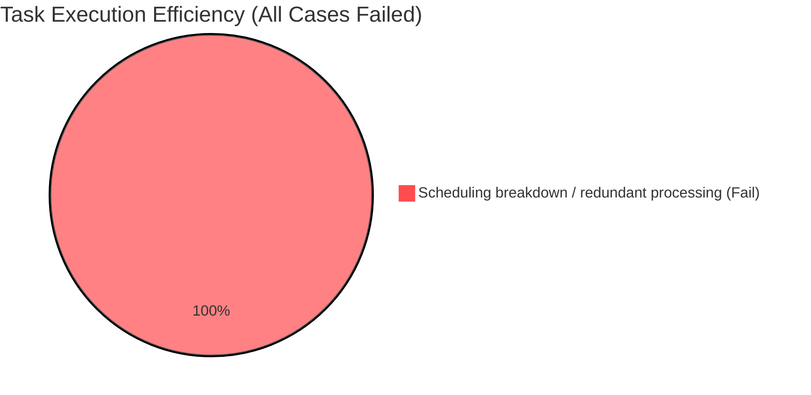

# Final Agent Test Evaluation Report

## 1. Execution Summary and Key Metrics

- **Total test cases executed:** 6
- **Average latency:** 43923.3 ms
- **Risk rating:** **Very High Risk**

**Key findings:** A targeted audit of high-load document parsing found serious flaws in the agent's resource-scheduling decisions across six adversarial cases. Every evaluated execution path was classified as noncompliant:

1. **Overcompensation under concurrency constraints:** When a low-cost parser returned a 429 rate-limit error, the agent neither applied exponential backoff nor queued the work. Instead, it silently upgraded the remaining tasks to an expensive tool, ignoring cost limits and resource tiers.
2. **Costly redundancy caused by broken decision loops:** During follow-up requests in the same session, the agent failed to recall previous results and repeated physical parsing of an already processed document.
3. **Severe response-latency escalation:** Switching to heavyweight, high-cost tools caused average response times to exceed 43 seconds, undermining high-concurrency operation and potentially causing frontend connections to time out.

## 2. Execution Details and Case Analysis

### Distribution of Execution Efficiency and Reuse Outcomes

### Representative Case: Rate-Limit-Induced Tool Escalation and Redundant Calls

**Test scenario:** Simulate processing a large batch of heterogeneous documents under high concurrency. Immediately after the initial batch analysis, ask a follow-up question about one of the documents.

* **Agent's actual behavior:**
  When the low-cost text parser encountered simulated concurrency limits, the agent routed remaining work to the expensive **Deep Vision Analyzer**, without retries or notifying the user. During a subsequent follow-up, it performed another physical scan lasting 14.6 seconds even though structured results from the first pass were already available.

* **Evaluation findings:**
  * **Factual-accuracy audit:** The final text was factually accurate, but the cost of achieving that accuracy was excessive. Re-parsing known information indicates a disconnect between the agent's knowledge cache and execution gateway.
  * **Semantic reasoning-chain audit:** The agent understood the follow-up request but failed to select the branch that reuses previous results. It did not demonstrate the closed-loop reasoning needed for complex, multi-turn, resource-intensive tasks.
  * **Resource scheduling and cost awareness:** The execution path was rated catastrophic. A blind switch to a high-cost tool after HTTP 429 errors, followed by needless repeated work, caused a sharp increase in token consumption and violated cost constraints.

## 3. Recommendations for Improvement

1. **Implement cost-aware task routing:** Enforce resource quotas at the system gateway. When a low-cost service encounters rate limits, prefer queueing or controlled retries instead of silently invoking costly alternatives without authorization.
2. **Strengthen session-level caching and reuse:** Before starting physical parsing, the agent must check context identifiers for previously processed items. Reuse available structured information rather than performing duplicate expensive calls.
3. **Add execution-efficiency circuit breakers:** Set maximum acceptable latency and cost thresholds for each task. If a proposed route is predicted to exceed the thresholds (e.g., more than 30 seconds or a sudden cost spike), stop and offer the user retry or simplified-processing options.

## 4. Final Assessment

**Recommended action: Suspend testing and deployment of this version in production and require redesign of its resource-scheduling logic.**

The agent's engineering efficiency is inadequate: nearly 44 seconds of average response latency combined with uncontrolled repeated parsing could produce unacceptable computational costs at scale. Deployment should not be considered until caching and rate-limit management are redesigned.
